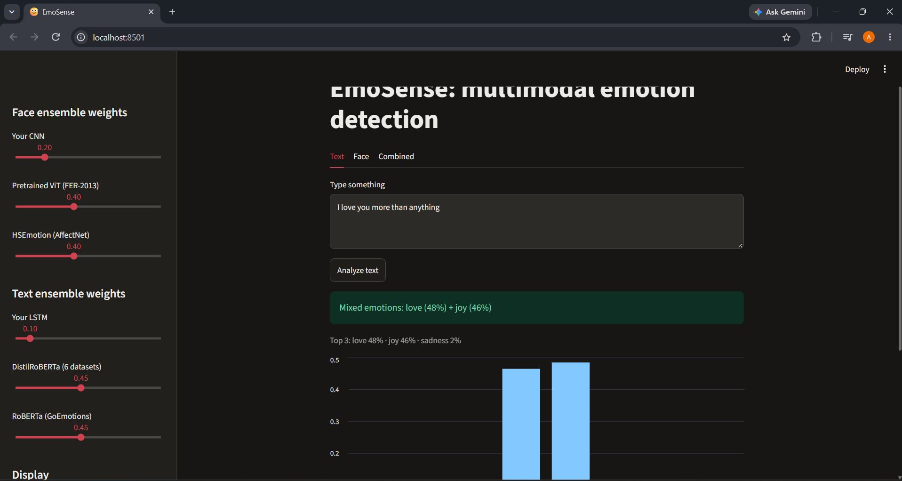
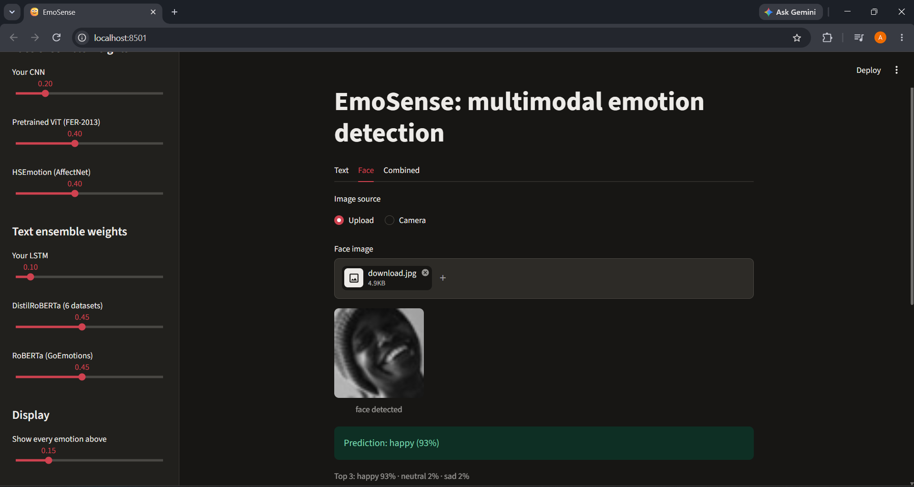

# EmoSense: Multimodal Emotion Detection

EmoSense detects emotion from text, from a face photo, or from both together. It combines models I trained from scratch in PyTorch with pretrained models, and shows the top emotions instead of a single label.

## Screenshots

| Text | Face |
|------|------|
|  |  |git reset

## Features

- Text tab: type a sentence and get emotion probabilities.
- Face tab: upload a photo or use the webcam. A face is detected, cropped and classified.
- Combined tab: fuses the text result and the face result with an adjustable weight.
- Multi-emotion output: shows every emotion above a confidence threshold (default 15%), plus a Top 3 line, because the second emotion is often close to the first.
- Sidebar sliders to change how much each model counts in the ensemble.

## How it works

### Models trained by me (PyTorch)

| Task | Model | Dataset | Result |
|------|-------|---------|--------|
| Text | Embedding + bidirectional LSTM | dair-ai/emotion (6 classes) | about 92% test accuracy |
| Face | 6-layer CNN with BatchNorm and dropout | FER-2013 (7 classes, 48x48 grayscale) | 62.0% test accuracy |

The face CNN was trained with augmentation (random crop, flip, rotation, brightness and contrast jitter, autocontrast, random erasing), label smoothing and a OneCycle learning rate schedule.

### Pretrained models used in the ensemble

| Task | Model | Trained on |
|------|-------|-----------|
| Face | trpakov/vit-face-expression (ViT) | FER-2013 |
| Face | HSEmotion enet_b0_8_best_vgaf (EfficientNet-B0, via hsemotion-onnx) | AffectNet |
| Text | j-hartmann/emotion-english-distilroberta-base | six emotion datasets (tweets, Reddit, TV dialogue, self-reports) |
| Text | SamLowe/roberta-base-go_emotions | GoEmotions (Reddit, 28 labels) |

### Ensemble

Each side (text, face) averages the probability outputs of its models with adjustable weights.

- Face defaults: my CNN 0.2, ViT 0.4, HSEmotion 0.4. The face CNN and the ViT also average their prediction with a mirrored copy of the face.
- Text defaults: my LSTM 0.1, DistilRoBERTa 0.45, GoEmotions 0.45.
- The GoEmotions model is multi-label with 28 outputs. I group them into the shared text classes (for example anger, annoyance and disapproval count as anger) and take the highest score in each group. This grouping is my own choice.
- Contempt (from HSEmotion) has no matching class and is dropped.
- For the Combined tab, text labels are mapped to the 7 face classes (joy and love map to happy) and the two results are blended with a slider.

### Face detection

OpenCV Haar cascades, tried on the image at several tilt angles, then a profile-face detector. If no face is found, the app uses a centre crop and shows a warning that the result is unreliable.

## Project structure

```
emotion_project/
  app.py              Streamlit app (inference and ensemble)
  models.py           shared model definitions, labels and preprocessing
  train_text.ipynb    trains the text LSTM, saves weights and vocabulary
  train_face.ipynb    trains the face CNN, saves weights
  saved/              text_lstm.pth, face_cnn.pth, vocab.json, text_config.json
  data/               FER-2013 images (train/ and test/); not committed
```

## Setup

Python 3.12 is recommended.

```
pip install torch torchvision streamlit datasets pandas numpy scikit-learn pillow
pip install transformers hsemotion-onnx "opencv-python<5"
```

Use OpenCV 4 (`opencv-python<5`). OpenCV 5 does not ship the Haar cascade files that face detection needs. If installing another package upgrades OpenCV, reinstall it with the line above.

### Run the app

```
streamlit run app.py
```

The first launch downloads the pretrained models from Hugging Face and GitHub (roughly 1 GB in total), so it needs internet once and starts slowly. After that they are cached.

### Retrain the models (optional)

1. Download FER-2013 from Kaggle and place it as data/train/<emotion>/ and data/test/<emotion>/.
2. Run train_text.ipynb (a few minutes). The dair-ai/emotion dataset downloads automatically.
3. Run train_face.ipynb (about 25 epochs; a CPU run can take a long time).
4. Both notebooks write their outputs to saved/.

## Limitations

- FER-2013 is small, low resolution and noisy. Face models trained on it do worse on real webcam photos than on its own test set, and they often fall back to neutral on subtle expressions.
- Disgust is almost never predicted by my CNN (111 test images, about 1% recall). Fear is also weak.
- The best checkpoint of the face CNN was chosen on the test set, so the 62.0% figure is slightly optimistic.
- The ViT was also trained on FER-2013, so the face ensemble is not three independent sources of evidence. HSEmotion (AffectNet) is the most different one.
- I have not measured the accuracy of the full ensemble. The model scores above are for my own models only.
- Text models struggle with sentences that have no emotion words, very short fragments and sarcasm. For example, "the audacity of that man" gets a mixed, uncertain result.
- The text LSTM was trained on tweet-style sentences and is weaker on ordinary writing, which is why it has a low default weight.
- Emotion recognition is imperfect and should not be used for decisions about people.

## Privacy

Photos are processed in memory by the app and are not saved by it.

## Possible next steps

- Fine-tune a pretrained model on FER-2013 and AffectNet for better real-world faces.
- Measure the ensemble on a held-out set and pick weights from it.
- Replace the Haar cascades with a stronger face detector.

## Credits

- FER-2013 (Kaggle), dair-ai/emotion (Hugging Face), GoEmotions (Demszky et al., 2020).
- trpakov/vit-face-expression, j-hartmann/emotion-english-distilroberta-base, SamLowe/roberta-base-go_emotions.
- HSEmotion / EmotiEffLib by Andrey Savchenko.

